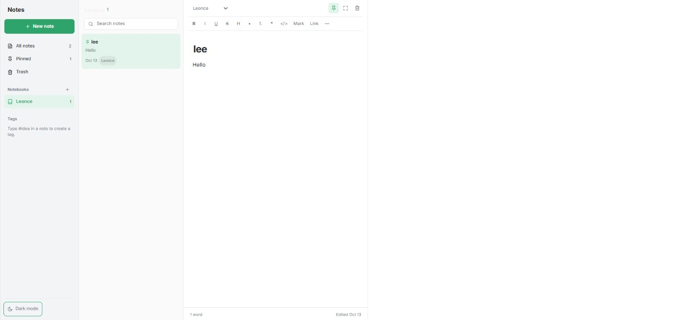
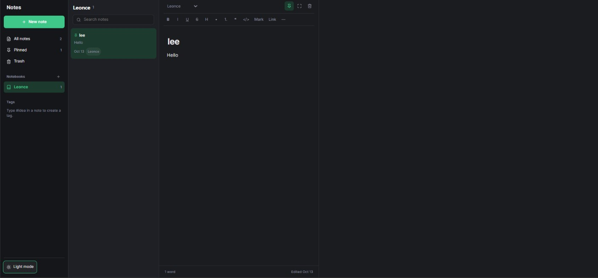

# Minimalist Notes Web Application

A clean, responsive, and intuitive **Notes Web Application** designed for seamless thought-capture, organization, and formatting. The application provides an elegant user interface available in both **Light Mode** and **Dark Mode** to adapt to any environment.

---

## 🌓 Themes

### Light Mode
Optimized for high-contrast visibility and a crisp reading experience during daytime use.

### Dark Mode
Engineered with soft, low-light tones to prevent eye strain during late-night productivity sessions.

---

## ✨ Features

### 🗂️ Advanced Organization
* **Smart Filtering:** Quickly navigate using dedicated sections for **All Notes**, **Pinned Items**, and **Trash**.
* **Notebooks:** Categorize thoughts into dedicated notebooks (e.g., *Leonce*) with real-time note counts.
* **Tagging System:** Easily generate tags directly within the text area simply by typing `#idea`.

### 📝 Text Formatting Workspace
The built-in rich-text editor supports essential markdown and typographic layouts:
* **Text Styles:** Bold (`B`), Italic (`I`), Underline (`U`), Strikethrough (`S`), and Headers (`H`).
* **Lists:** Create structured ordered or bulleted lists.
* **Blocks & Elements:** Insert quotes (`❝`), inline code tags (`</>`), highlights, links, and horizontal dividers (`—`).

### 📊 Real-Time Metadata
* Monitors document analytics instantly with an integrated **word counter**.
* Keeps track of version history via auto-saved indicators (e.g., *Edited Oct 13*).
